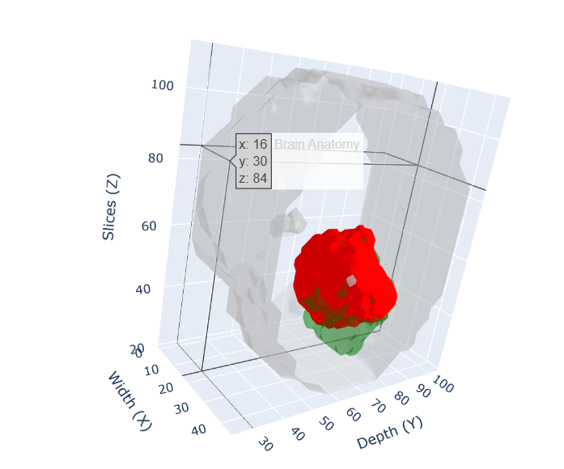

<h1 align="center"><span style="color:#2563eb">Brain Tumor Segmentation</span> using U-Net</h1>

<p align="center">
  
  
</p>

<p align="center">
  
  
  
</p>

> **A deep-learning research prototype for pixel-wise brain MRI tumor segmentation**, trained with TensorFlow/Keras in Google Colab and designed to support visual inspection of predicted tumor masks.

## Project Pitch

Brain tumor boundaries can be difficult to inspect consistently across MRI slices. This project explores how a U-Net semantic-segmentation model can learn to label each pixel in a preprocessed brain MRI slice, then visualize the predicted mask alongside the original scan.

The project combines a Colab training workflow, image/mask preprocessing, model evaluation, and visual outputs—including a prototype 3D visualization from multiple ordered slices. A lightweight Streamlit interface can be used separately for uploading an MRI image and viewing the model prediction.

**Important:** This is an educational/research prototype, not a clinically validated diagnostic tool. Predictions must not be used to make medical decisions.

## Results

The following figures are copied from the outputs saved in `cnn_tumor.ipynb`.

### Final test-set metrics

| Metric | Recorded value |
|---|---:|
| Test loss (categorical cross-entropy) | `0.0346` |
| Test accuracy | `0.9930` (**99.30%**) |
| Test precision | `0.9936` (**99.36%**) |
| Test recall | `0.9925` (**99.25%**) |

### Final validation metrics (epoch 10)

| Metric | Recorded value |
|---|---:|
| Validation loss | `0.0346` |
| Validation accuracy | `0.9931` (**99.31%**) |
| Validation precision | `0.9937` (**99.37%**) |
| Validation recall | `0.9926` (**99.26%**) |

These are the aggregate metrics reported by the notebook's Keras evaluation. They are **not** class-wise tumor Dice/IoU scores or evidence of clinical performance. Pixel-level metrics can be strongly influenced by the large background area. Class-wise Dice, IoU, sensitivity, specificity, and patient-level evaluation should be added before drawing stronger conclusions.

## Dataset and split

The notebook reports **11,163 matching image–mask pairs** after preprocessing.

| Split | Image–mask pairs | Approximate share |
|---|---:|---:|
| Training | 7,814 | 70% |
| Validation | 1,674 | 15% |
| Test | 1,675 | 15% |
| **Total** | **11,163** | **100%** |

The notebook shuffles paired slices with `random_state=42` and then splits the slices. It does not demonstrate a patient-level split. If multiple slices from the same patient appear in different splits, the evaluation may be optimistic; patient-level separation is recommended for a more reliable estimate of generalization.

The notebook references BraTS 2021 data. Check the original dataset terms and access conditions before redistributing data. Do not commit the MRI dataset or private patient data to this repository.

## Model and training setup

- **Architecture:** U-Net encoder–decoder with skip connections.
- **Framework:** TensorFlow / Keras.
- **Input shape:** `128 × 128 × 1` (grayscale MRI slice).
- **Output:** Four-class pixel-wise segmentation.
- **Total parameters:** `7,707,652`.
- **Trainable parameters:** `7,702,020`.
- **Non-trainable parameters:** `5,632`.
- **Optimizer:** Adam.
- **Learning rate:** `0.0001`.
- **Loss:** Categorical cross-entropy.
- **Batch size:** `32`.
- **Maximum epochs configured:** `10`.
- **Checkpoint:** `best_unet_model.keras`, saved when validation loss improves.
- **Early stopping:** monitors validation loss with patience `2`; the saved run restored weights from epoch 10.

### Preprocessing in the notebook

1. MRI slices and masks are resized to `128 × 128`.
2. A Gaussian blur with a `5 × 5` kernel is applied to image slices.
3. Grayscale image values are converted to `float32` and divided by `255.0`.
4. The mask label `4` is remapped to class index `3`.
5. Masks are converted to four-class one-hot representations.

The class-index convention used by the notebook is:

| Model class index | Source mask label | Meaning |
|---:|---:|---|
| 0 | 0 | Background |
| 1 | 1 | NCR/NET (as labelled in the source masks) |
| 2 | 2 | Edema |
| 3 | 4 | Enhancing tumor |

Verify these labels against the exact dataset/version and mask preprocessing used in your workflow before interpreting results.

## Features

- Colab notebook with preprocessing and training steps.
- Paired MRI image/mask processing.
- U-Net model training with checkpointing and early stopping.
- Training/validation accuracy and loss plots.
- Test-set evaluation.
- Visual comparison of original scan, ground-truth mask, predicted mask, and tumor extraction.
- Prototype 3D visualization built from multiple slices.
- Intended integration with a simple upload-based Streamlit UI.

### About the 3D view

The notebook's 3D visualization searches for multiple slices associated with a patient ID and stacks them to create a surface view. A meaningful reconstruction requires correctly matched, ordered slices from the same scan and appropriate spatial spacing/orientation. The rendered surface is for visualization only and should not be treated as a clinically accurate 3D reconstruction without those checks.

## Repository structure

A suggested layout for publishing the project:

```text
brain-tumor-segmentation-unet/
├── notebooks/
│   └── cnn_tumor.ipynb
├── src/
│   ├── model_loader.py
│   └── preprocessing.py
├── app.py
├── outputs/
│   ├── sample_mri.png
│   ├── ground_truth_mask.png
│   ├── predicted_mask.png
│   └── segmentation_overlay.png
├── requirements.txt
├── .gitignore
└── README.md
```

Adjust the tree to match the files that actually exist in your repository. Only include output images that you have generated and verified.

## Run the notebook

1. Open `notebooks/cnn_tumor.ipynb` in Google Colab.
2. Select a suitable runtime (GPU can reduce training time).
3. Follow the notebook's dataset setup and access steps. Dataset access credentials should be configured privately in Colab Secrets or another secure method—not written into the notebook.
4. Run preprocessing, dataset splitting, model training, evaluation, and visualization cells in order.
5. Save a copy of the trained model as `best_unet_model.keras`.

The notebook currently includes Google Drive and dataset-archive paths that are specific to the original Colab environment. Update those paths if you use a different Drive account or folder layout.

## Run the Streamlit UI

If `app.py`, `src/model_loader.py`, and `src/preprocessing.py` are present in the repository:

```bash
pip install -r requirements.txt
streamlit run app.py
```

Place the trained `best_unet_model.keras` where the model loader expects it, or update the model path in your configuration. The `.keras` model is large, so consider GitHub Releases or external model storage if it is not appropriate for a normal Git commit.

The exact `requirements.txt` should be generated from the imports used by your actual UI and notebook; dependencies may include TensorFlow, Streamlit, OpenCV, NumPy, Matplotlib, scikit-image, and Plotly.

## Example outputs

Commit a few non-sensitive, representative examples so visitors can inspect results without running the notebook:

- Original MRI slice
- Ground-truth segmentation mask
- Predicted segmentation mask
- Overlay of prediction on the MRI
- Training/validation curves
- 3D visualization screenshot, if generated from verified ordered slices

For notebooks to show results directly on GitHub, save the `.ipynb` **with output cells** before uploading it.

## Limitations and next steps

- This project is a prototype and has not been established as clinically safe or validated for diagnosis.
- The reported aggregate metrics are not substitutes for class-wise Dice/IoU and patient-level validation.
- A patient-level train/validation/test split should be verified to avoid slice-level leakage.
- Add per-class Dice, IoU, confusion matrices, and visual failure-case analysis.
- Verify preprocessing and label mappings against the exact dataset version.
- Validate the 3D slice order, spacing, and orientation before making anatomical claims.
- Test the upload UI with images that match the training modality and preprocessing assumptions.

## Security and data handling

- **Never commit API tokens, Kaggle credentials, passwords, or other secrets.** If a credential has already been committed to a notebook or pushed to GitHub, revoke/rotate it immediately and remove it from the notebook and Git history as appropriate.
- Do not publish raw medical data or patient-identifying information.
- Review dataset licensing and redistribution requirements before sharing any data.

## Disclaimer

This repository is intended for learning and research into medical-image segmentation. It is not a medical device, does not provide a diagnosis, and must not replace review by qualified medical professionals.

## Acknowledgements

The notebook references the BraTS 2021 brain tumor MRI dataset. Please cite and follow the official dataset terms applicable to the data you used. Add any additional source, paper, or repository attribution required by your implementation.
